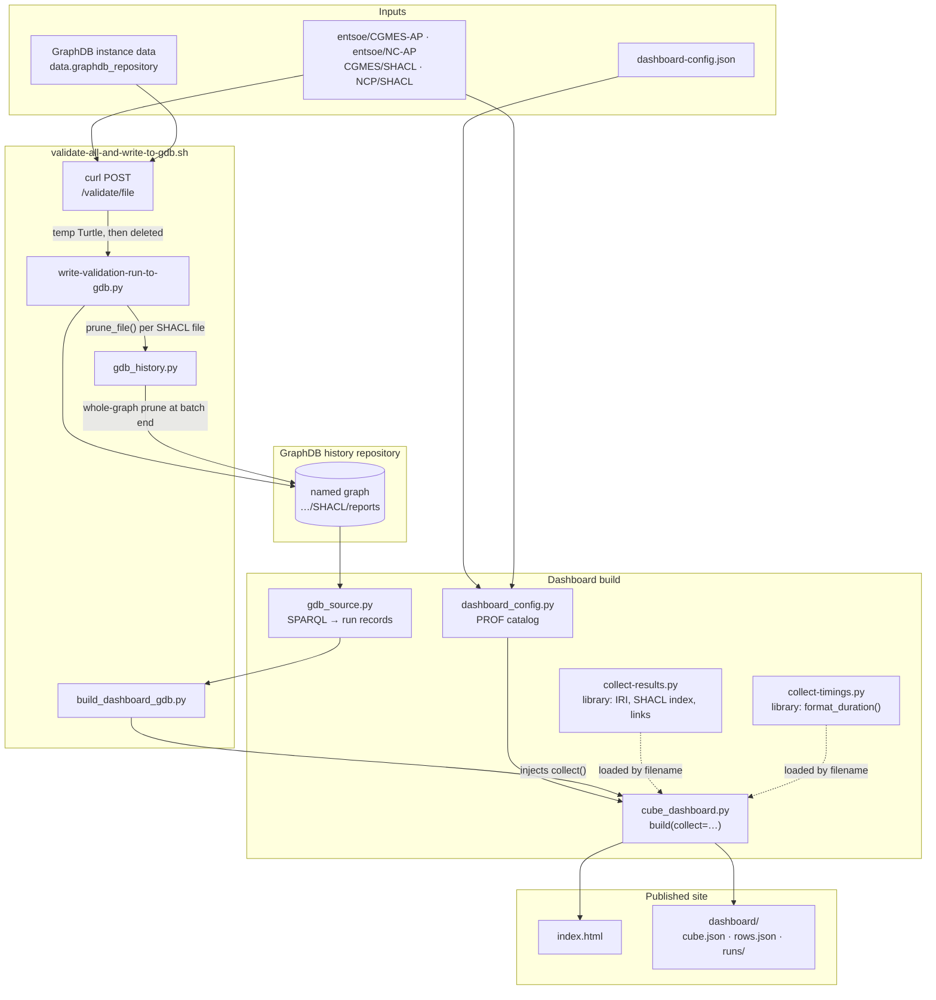

# ReliCapGrid ENTSO-E × Application-Profiles SHACL evaluation

SHACL validation of the **ReliCapGrid ENTSO-E** test data against the CGMES
and NCP (Network Code Profiles) Application-Profiles shapes. Every validation
run is recorded in a GraphDB named graph, and the latest run of each SHACL file
is rendered as a browsable static dashboard.

**[View the dashboard →](https://nataschake.github.io/relicap-ap-shacl-eval/)**

## Links

- **Shapes** — [`entsoe/CGMES-AP`](https://github.com/entsoe/CGMES-AP) (`CGMES/SHACL`) and [`entsoe/NC-AP`](https://github.com/entsoe/NC-AP) (`NCP/SHACL`).
- **Data** — [`entsoe/relicapgrid`](https://github.com/entsoe/relicapgrid),
  loaded into the GraphDB repository
  [`relicapgrid` on a local GraphDB instance](http://localhost:7200/).
- **Results** — [dashboard on GitHub Pages](https://nataschake.github.io/relicap-ap-shacl-eval/), with family matrices, timings, and focus-node drill-down pages.

## One pipeline

```bash
export GDBUSER=<username>
export GDBPASS=<password>
./validate-all-and-write-to-gdb.sh
```

That single script does everything:

1. **Validate** — POST every SHACL file listed in `dashboard-config.json` to
   the GraphDB validation endpoint for `data.graphdb_repository`, one request
   per file.
2. **Record** — parse each response with `write-validation-run-to-gdb.py` and
   append it to the validation-history named graph. No `validation-report.ttl`
   or `timing.txt` is ever written to disk.
3. **Prune** — re-apply the retention window with `gdb_history.py`, so the
   graph keeps the last two timings per file and the results of the newest run.
4. **Build** — rebuild `index.html` and `dashboard/` from that graph with
   `build_dashboard_gdb.py`.



`collect-results.py` and `collect-timings.py` are libraries loaded by
`cube_dashboard.py`, not pipeline steps.

Rebuilding the dashboard without revalidating is one command:

```bash
python3 build_dashboard_gdb.py
```

## Layout

```
relicap-ap-shacl-eval/
├── validate-all-and-write-to-gdb.sh  # the pipeline: validate → record → prune → build
├── write-validation-run-to-gdb.py    # writes one validation run into the history graph
├── gdb_history.py              # retention window for that graph + standalone pruner
├── gdb_source.py               # SPARQL reader for the GraphDB validation-history graph
├── build_dashboard_gdb.py      # dashboard entry point + run-history page
├── cube_dashboard.py           # cube construction and static page generation
├── dashboard_config.py         # validated config + PROF source catalog
├── dashboard-config.json       # repositories, families, history graph, retention, links
├── collect-results.py          # library: IRI shortening, SHACL index, GitHub/GraphDB links
├── collect-timings.py          # library: duration formatting
├── dashboard.css               # shared styles for the dashboard
├── validation-result-model.ttl # the shape of what is written into the graph
├── index.html                  # dashboard: frontmatter stats + links to family pages
└── dashboard/
    ├── r/                      # repository/family/profile/shape pages
    ├── runs/                   # every recorded run, with Δ against the previous one
    ├── **/rows.json            # per-scope sort payload, fetched on first sort
    └── cube.json               # whole cube as one machine-readable artifact
```

`collect-results.py` and `collect-timings.py` are helper libraries loaded by
`cube_dashboard.py`, not commands — they have no `main()` and read no files.

## The dashboard

`build_dashboard_gdb.py` writes a four-dimensional static cube:

```
all repositories → repository → family → ontology profile → individual SHACL shape
```

- `index.html` contains one aggregation row per configured shapes repository.
- `dashboard/r/<repository>/index.html` aggregates its configured families.
- `dashboard/r/<repository>/f/<family>/index.html` aggregates ontology profiles.
- `dashboard/r/<repository>/f/<family>/p/<profile>/index.html` shows individual
  shapes. The frontmatter links to the profile's RDFS ontology on GitHub.
- `.../s/<shape>/index.html` grounds one shape. Its frontmatter links to the exact
  SHACL declaration line; error and warning counts open focus-node evidence.

Every level uses timing sum/max, errors, warnings, distinct errors, distinct
warnings, good shapes, and total shapes. Landing, repository, and family
frontmatter also shows **Validation execution errors**: runs that produced no
SHACL `sh:ValidationReport`, plus configured SHACL files with no run in the
graph at all. The tile links to the affected SHACL files, HTTP statuses,
and returned error text. Validation measures are additive, and the build checks
every rollup. A shape is classified in exactly one bucket (error takes precedence
over warning), so:

```
distinct errors + distinct warnings + good shapes = total shapes
```

Errors and warnings count distinct focus nodes **per individual shape** and are
summed upward. Timing uses unique SHACL-file validation runs, so a run is counted
once at profile/family/repository levels. Until per-shape timings are queried
from GraphDB, each shape repeats its containing file's run time as non-additive
context.

All non-zero measures are links. Aggregate links open lower-level rows ordered
by that measure. Shape-level error/warning links open paginated evidence with
`sh:focusNode`, GitHub, `sh:message`, and `sh:sourceConstraint` columns.

### Sorting

Every column header on an aggregation table reorders the table by that measure:
first click descending, second ascending, third back to the default order. The
order is written into the page address as `#sort=<measure>&dir=<asc|desc>&page=<n>`,
so a sorted view can be bookmarked or shared, and measure links from the level
above land on an already-sorted table.

Sorting covers the scope's whole child set, not just the rows on the current
page, so it stays correct on profiles large enough to paginate. Each scope
directory carries a `rows.json` sidecar with its child rows; the browser fetches
it on the first sort only, so the default view costs no extra request. With
JavaScript off, or if the sidecar cannot be fetched, the pre-rendered tables and
their `p<n>.html` pages work exactly as before.

`dashboard/cube.json` holds the whole cube — every repository, family, profile,
and shape with all measures — for cross-cutting questions that no single page
answers. Pages do not read it. Shape entries carry no `page`: it is always the
parent profile's page directory plus `s/<id>/index.html`.

Links on the drill-down pages:

- `sh:focusNode` → GraphDB resource explorer when the IRI is in `data.graphdb_repository`; otherwise unlinked text.
- GitHub → code search in `data.instance_github_repository` for the same IRI.
- `sh:sourceConstraint` / shape name → the matching constraint in the profile SHACL file (`CGMES/SHACL` or `NCP/SHACL`).

### Configuration

`dashboard-config.json` is the source of repository/family configuration. A
repository defines its checkout, upstream GitHub repository/ref, and an
extensible family list. Each family defines SHACL, RDFS, and PROF directories
plus optional `profile_overrides`.

PROF manifests provide the SHACL-to-ontology mapping, including CGMES
many-SHACL-to-one-RDFS mappings. Artifacts referenced by multiple profiles are
counted once under `Shared constraints (no single ontology)`. An explicit
override maps a SHACL filename to a PROF-derived profile ID.

## Truncation in the source reports

GraphDB caps each report at **1,000 results per constraint component** and
**10,000 per report**. When a cap is hit the report carries
`rdf4j:truncated true` and that profile's count is a **lower bound**.
Re-run with higher `validationResultsLimitPerConstraint` /
`validationResultsLimitTotal` for exact counts.

## How the runs are produced and stored

Validation runs against the instance-data repository named in
`data.graphdb_repository` (currently `relicapgrid`) on the GraphDB at
`validation_history.base_url`, which requires authentication.
`validate-all-and-write-to-gdb.sh` reads those values from
`dashboard-config.json`, logs in to obtain a bearer token, then validates
each configured SHACL file:

```bash
eval "$(python3 dashboard_config.py --export-shell)"
# authenticate and extract the bearer token
auth_header=$(curl -s "${GDB_URL}rest/login/<username>" \
  -X POST -H 'X-GraphDB-Password: <password>' -I | grep -i "authorization:")
token=${auth_header#*: }

# validate a shape file using the token
curl -X POST --header 'Accept: text/turtle' \
  -H "Authorization: Bearer ${token%$'\r'}" \
  "${GDB_URL}rest/repositories/${VALIDATE_REPO}/validate/file" \
  -F 'file=@<shape>.ttl;type=text/turtle'
```

Each response is parsed and appended immediately into
`validation_history.repository` / `validation_history.graph` by
`write-validation-run-to-gdb.py`. Nothing is kept on disk between the
validation request and the graph write, and the batch is re-runnable — there
is no resume script, because re-running simply appends fresh runs and the
retention window discards what falls outside it.

Each run is one `sh:ValidationReport` node carrying its own `ex:file`,
`ex:finishedAt`, `ex:durationSeconds`, `ex:httpStatus` and its own
`sh:result` → `sh:ValidationResult` nodes (`sh:focusNode`, `sh:sourceShape`,
`sh:resultSeverity`, `sh:resultMessage`, …), following
`validation-result-model.ttl`. The target graph is never dropped, so
re-running the script over time gives each SHACL file several timings, each
with the results that were valid at that time:

```sparql
PREFIX sh: <http://www.w3.org/ns/shacl#>
PREFIX ex: <http://example.org/ns#>
SELECT ?finishedAt ?durationSeconds ?focusNode ?severity WHERE {
  ?report a sh:ValidationReport ;
          ex:file "61970-456_StateVariables-AP-Con-Complex-SHACL.ttl" ;
          ex:finishedAt ?finishedAt ;
          ex:durationSeconds ?durationSeconds .
  OPTIONAL {
    ?report sh:result ?result .
    ?result sh:focusNode ?focusNode ; sh:resultSeverity ?severity .
  }
} ORDER BY ?finishedAt
```

Runs that return an error instead of a report are still recorded, flagged with
`ex:executionError true` and `ex:errorText`. Override the destination with
`GDB_HISTORY_REPOSITORY`, `GDB_HISTORY_GRAPH`, or `GDB_BASE_URL`.

## Building the dashboard from the graph

`build_dashboard_gdb.py` renders the cube from that history graph. It is the
only generator, and it writes `index.html` and `dashboard/`.

```bash
python3 build_dashboard_gdb.py                                # latest run per SHACL file
python3 build_dashboard_gdb.py --as-of 2026-09-20T00:00:00+03:00   # as of a point in time
python3 gdb_source.py                                         # just list the runs, no pages
```

A dashboard shows one state of the world, so the cube is built from the
**latest run per SHACL file** (or the latest at or before `--as-of`). The
landing frontmatter names the source repository and graph and links to
`dashboard/runs/index.html`, which lists every recorded run with its
`ex:finishedAt`, `ex:durationSeconds`, HTTP status, result count, outcome, the
change in run time against the previous run, and whether it is the run the
pages were built from. Each file there links to a GraphDB SPARQL query over its
own runs.

### History retention

The graph does not grow without bound. Per SHACL file it keeps:

| Kept | Default | Config key |
|------|---------|------------|
| Most recent runs (timings) | 2 | `validation_history.keep_timings` |
| Runs that keep their `sh:result` nodes | 1 (the newest) | `validation_history.keep_results` |

Two timings are what make the comparison possible: the landing page reports how
many files got slower or faster against the previous run, and the run-history
page shows a per-file Δ. Older runs keep their timing and status but no
results, which is where almost all the volume was — one full batch is roughly
19,000 result nodes.

Retention is applied per file as each run is written, so it is a property of
the upload rather than a cleanup job. Apply it to the whole graph at any time:

```bash
python3 gdb_history.py --dry-run   # report current size and the window
python3 gdb_history.py             # apply it (idempotent)
```

`validate-all-and-write-to-gdb.sh` runs it once more at the end of a batch, so
an interrupted batch still converges. Pass `--no-prune` to
`write-validation-run-to-gdb.py` to append without trimming.

Deletion is not reversible. Back the graph up before changing the window:

```bash
url=$(python3 -c "import dashboard_config as dc; from urllib.parse import quote; h=dc.history_settings(); print(f\"{h['sparql']}/statements?context={quote('<'+h['graph']+'>')}\")")
curl -s -H 'Accept: application/n-quads' "$url" -o history-backup.nq
```

Two things follow from reading runs out of a graph rather than a folder:

- A configured SHACL file with no run in the graph counts as one **validation
  execution error**, and shows up on the tile's evidence page.
- Reports in the graph that carry no `ex:file` cannot be attributed to a SHACL
  file. They are excluded, and their count is stated in the landing
  frontmatter.

Configure the source under `validation_history` in `dashboard-config.json`:

```json
"validation_history": {
  "base_url": "http://localhost:7200/",
  "repository": "cim-shacl",
  "graph": "https://github.com/entsoe/application-profiles/SHACL/reports",
  "index": "index.html",
  "dashboard_dir": "dashboard",
  "keep_timings": 2,
  "keep_results": 1
}
```

`GDB_BASE_URL`, `GDB_HISTORY_REPOSITORY`, and `GDB_HISTORY_GRAPH` override the
first three JSON fields. Scripts do not hardcode a history repository name;
they read `dashboard-config.json` through `dashboard_config.history_settings()`.

## Publishing

Building the dashboard needs the local GraphDB, which CI does not have, so the
generated `index.html` and `dashboard/` are committed and
`.github/workflows/dashboard.yml` only copies them to GitHub Pages. A pipeline
run becomes visible once its output is committed:

```bash
./validate-all-and-write-to-gdb.sh
git add index.html dashboard
git commit -m "Refresh dashboard"
```

Preview locally over HTTP (not `file://`, which blocks relative navigation):

```bash
python3 -m http.server 8765 --bind 127.0.0.1
# open http://127.0.0.1:8765/index.html
```
